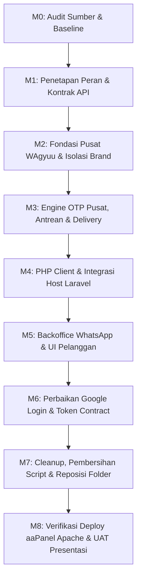

# IMPLEMENTATION PLAN — WAgyuu WhatsApp OTP & Backoffice Architecture

Versi: 1.0 (Berdasarkan PRD 16 November 2026)
Status: Active Execution Plan

---

## Ringkasan Milestone

---

## Milestone Detail

### M0 — Audit Sumber dan Baseline [SELESAI]
- [x] Eksekusi inventaris non-destruktif (`collect-inventory.ps1`, `check-document-package.ps1`).
- [x] Audit Git status (`wa-gateway` HEAD `80c3072`, working tree: `deleted: WA_LOGIN_SYSTEM.md` dipertahankan).
- [x] Verifikasi dependency lock: Laravel 13.35, Guzzle 8.2, Sanctum 4.3.3.
- [x] Jalankan baseline test lokal di host (`PhoneNumberTest` passed 18/18, `WhatsAppRegressionTest` passed 6/6).
- [x] Tetapkan host utama: `laravel-headless-starter`.
- [x] Buat dokumen memori kerja (`SOURCE_MAP.md`, `IMPLEMENTATION_PLAN.md`, `PROGRESS.md`, `DECISIONS.md`, `TEST_MATRIX.md`, `KNOWN_ISSUES.md`, `CLEANUP_MANIFEST.csv`).

### M1 — Penetapan Peran, ADR, dan Kontrak API
- [ ] Buat ADR formal:
  - ADR-01: Pusat mengelola sesi WhatsApp, antrean delivery, challenge OTP, dan verifier.
  - ADR-02: Laravel mengelola bot protection, browser session, database customer, dan session login.
  - ADR-03: SQLite + Redis untuk single-instance central demo; MySQL untuk Laravel host.
  - ADR-04: Adapter Baileys sebagai WhatsApp engine utama (ringan, WebSocket native, cocok tanpa headless Chrome/Docker).
- [ ] Dokumentasikan skema OpenAPI/JSON schema di `wa-gateway/packages/contracts/`.
- [ ] Tetapkan error code dan response envelope standar.

### M2 — Fondasi Pusat WAgyuu & Isolasi Brand
- [ ] Inisialisasi struktur aplikasi `wa-gateway/apps/gateway` (NestJS / TypeScript).
- [ ] Modul Brands & API Client authentication (brand-scoped Bearer token, least privilege).
- [ ] Modul Session WhatsApp (metadata session, status lifecycle, QR generator).
- [ ] Adapter Engine Baileys (inisialisasi socket, multi-device auth store, event listener status).
- [ ] Healthcheck Liveness & Readiness endpoint (`/v1/health/liveness`, `/v1/health/readiness`).

### M3 — Engine OTP Pusat, Antrean & Delivery
- [ ] Modul OTP Challenge:
  - Generator 4-digit numerik acak (`0000`–`9999`) via `crypto.randomInt`.
  - Verifier HMAC-SHA256 dengan server secret & context binding.
  - TTL 300 detik, cooldown 30 detik, kuota maksimal 5 percobaan per challenge.
- [ ] Delivery Engine & Outbox Worker (Redis queue / BullMQ):
  - Atomic sender lease selection (round-robin / least-recently-assigned di antara sender aktif milik brand).
  - Pacing & retry guard.
  - Pemrosesan status delivery (`queued -> preparing -> submitted -> delivered`).
- [ ] Idempotency middleware via `Idempotency-Key` header.
- [ ] Automated contract & unit tests untuk OTP logic.

### M4 — PHP Client & Integrasi Host Laravel
- [ ] Buat `CentralGatewayClient` di Laravel host (`laravel-headless-starter/api/app/Services/WhatsAppLogin/CentralGatewayClient.php`) menggunakan Laravel HTTP Client.
- [ ] Migration tabel lokal di host: `wa_login_attempts` dan `wa_webhook_events` (tanpa mengubah tabel `users` secara destruktif).
- [ ] Service `WhatsAppLoginService`:
  - Validasi Turnstile Siteverify di server.
  - Pengecekan limit & browser binding (HMAC session).
  - Request challenge ke pusat WAgyuu.
  - Verifikasi kode OTP & finalisasi login akun lokal via Sanctum guard.
  - Penanganan akun baru (auto-create member sesuai aturan host) vs akun suspend/nonaktif.
- [ ] Route adapter kompatibilitas: `/api/v1/auth/whatsapp/challenge-config`, `/request-otp`, `/resend-otp`, `/verify-otp`.
- [ ] Feature tests end-to-end di Laravel host (SQLite in-memory).

### M5 — Backoffice WhatsApp & UI Pelanggan
- [ ] Backoffice Admin (React Vite di `laravel-headless-starter/apps/react`):
  1. **Sesi WhatsApp**: Daftar sender, status, tombol tambah nomor, QR pairing box persegi (tanpa distorsi).
  2. **Tampilan Login**: Form preview pesan, konfigurasi template (`Kode login :brand Anda: :code...`).
  3. **Uji OTP & Pesan**: Tab uji kirim pesan manual ke nomor trial, tab uji alur OTP terisolasi.
  4. **Log Transaksi**: Tabel riwayat pengiriman berfilter (request ID, timestamp, masking nomor, status).
  5. **Member Terverifikasi**: Filter view dari daftar users yang login via WhatsApp.
- [ ] UI Pelanggan (Form Login WhatsApp di `AuthModal`):
  - Normalisasi input nomor telepon Indonesia (`08...`, `62...`, `+62...`).
  - Proteksi widget Cloudflare Turnstile.
  - Input 4 digit OTP terpisah dengan auto-focus & auto-submit saat 4 digit lengkap.
  - Countdown timer resend (30 detik).
  - Penanganan error responsif (`NO_SENDER_AVAILABLE`, `OTP_INVALID`, `RESEND_COOLDOWN`).

### M6 — Perbaikan Google Login & Token Contract
- [ ] Audit `AuthModal.tsx` dan `AuthController.php`.
- [ ] Perbaiki kontrak token Google Identity Services (GIS): bedakan `id_token` (JWT verifikasi server via Google Client ID) dan `access_token`.
- [ ] Tambahkan konfigurasi aman di `.env.example` dan penanganan graceful jika credential Google belum diatur (tidak merusak seluruh modal login).

### M7 — Cleanup, Pembersihan Script & Reposisi Folder
- [ ] Identifikasi dan catat semua script patch sekali pakai (`patch.js`, `patch2.js` ... `patch_ts.js`).
- [ ] Lepaskan ketergantungan import frontend terhadap salinan `src/openwa` dan pensiunkan modul yang tidak terpakai ke `CLEANUP_MANIFEST.csv`.
- [ ] Pastikan tidak ada credential rahasia yang tertinggal di bundle, log, atau repositori publik.
- [ ] Verifikasi build production: `npm run build` di frontend dan `composer validate` di API.

### M8 — Verifikasi Deploy aaPanel Apache & UAT Presentasi
- [ ] Konfigurasi deployment non-Docker untuk aaPanel:
  - Systemd service template untuk WAgyuu runtime (`wagyuu-gateway.service`).
  - Konfigurasi Apache virtual host dan reverse proxy untuk path `/v1` ke gateway loopback.
  - Perlindungan direktori privat (`.env`, storage, session).
- [ ] Eksekusi skenario presentasi UAT sesuai dokumen `06-SKENARIO-PRESENTASI-DAN-UAT.md` (AC-01 hingga AC-36).
- [ ] Final handoff report & dokumentasi README (Indonesia & Inggris).
